<a href="https://gorzaweba.github.io/Gravity.io/">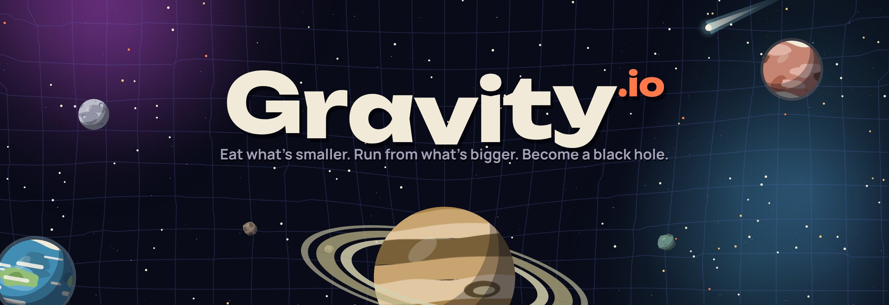</a>

<p align="center">
  <a href="https://gorzaweba.github.io/Gravity.io/">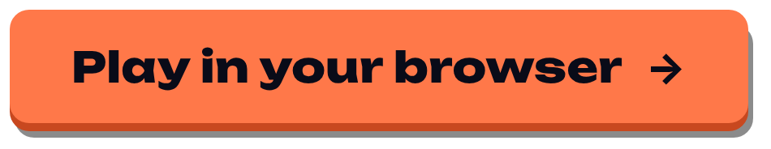</a>
</p>

<p align="center">
  Free &nbsp;·&nbsp; no install, no account &nbsp;·&nbsp; phone, tablet or desktop
  <br>
  <a href="#how-to-play">How to play</a> &nbsp;·&nbsp; <a href="#seven-forms">Seven forms</a> &nbsp;·&nbsp; <a href="#staying-alive">Staying alive</a> &nbsp;·&nbsp; <a href="#run-it-yourself">Run it yourself</a>
</p>

<br>

You start as a rock the size of a pebble. Everything with mass pulls on everything lighter than itself, so the space around you is a vacuum for stardust and smaller bodies, and the space around anything heavier is a trap. Eat your way up through seven forms, and keep out of the wells of whatever wants to eat you.

<p align="center">
  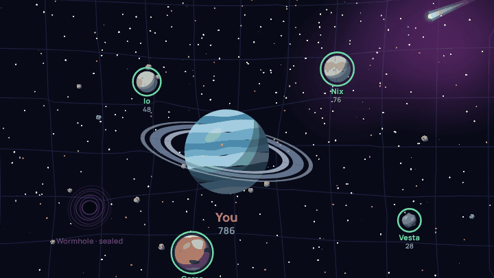
  <br>
  <sub>A gas giant fires a gravity surge and reels in three moons.</sub>
</p>

<p align="center">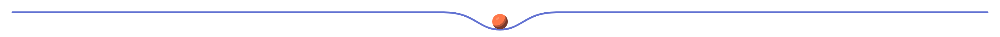</p>

## How to play

| | | Desktop | Phone or tablet |
| :---: | :--- | :--- | :--- |
|  | **Steer** | Mouse (the farther the cursor, the faster) or <kbd>W</kbd><kbd>A</kbd><kbd>S</kbd><kbd>D</kbd> | Drag anywhere. A stick appears under your thumb |
|  | **Boost** | Hold <kbd>Space</kbd> or left click. Faster, but it burns mass | Hold **Boost** |
|  | **Gravity surge** | <kbd>E</kbd>, <kbd>Shift</kbd> or right click. Pulls 2.2× harder for 2.6 s, recharges in 14 s | Tap **Surge** |

Pause with <kbd>Esc</kbd>, mute with <kbd>M</kbd>, turn the music on or off with <kbd>N</kbd>, go full screen with <kbd>F</kbd>. On a phone those are the buttons at the top and the switches on the pause screen.

<p align="center">
  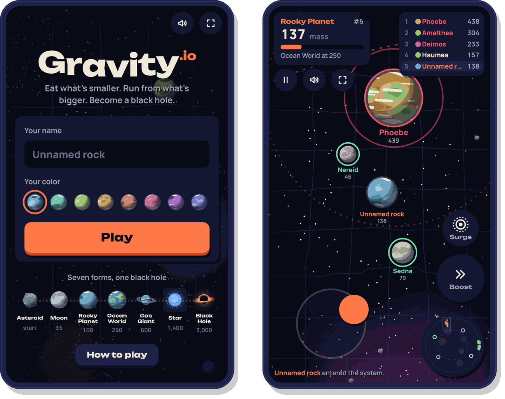
  <br>
  <sub>Portrait or landscape. Add it to your home screen and it opens full screen, like an app.</sub>
</p>

<p align="center"></p>

## Seven forms

Every form looks different and pulls harder than the one before it.

| | Form | Reached at | What changes |
| :---: | :--- | ---: | :--- |
| 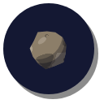 | **Asteroid** | start | You absorb stardust and smaller rocks |
|  | **Moon** | 35 | Heavy enough to swallow comets |
| 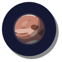 | **Rocky Planet** | 100 | Gravity +8% |
| 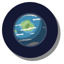 | **Ocean World** | 250 | Gravity +15% |
| 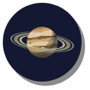 | **Gas Giant** | 600 | Gravity +25%, wider pull |
| 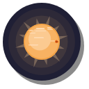 | **Star** | 1,400 | Gravity +40% |
| 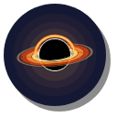 | **Black Hole** | 3,000 | Gravity +80%, but Hawking radiation eats your mass faster |

<p align="center"></p>

## Staying alive

| | What's out there |
| :---: | :--- |
| 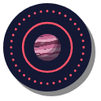 | **Red rings.** When something heavy is pulling on you, two rings appear around it. The dotted one is where its pull starts. Inside the solid one its pull beats your engine, and only a boost gets you out. |
| 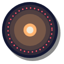 | **Supernovae.** Every 45 to 75 seconds a star starts pulsing. You get five seconds to clear its red ring. Anything caught inside loses 18% of its mass, and the blast leaves stardust and a pulsar worth 45. |
| 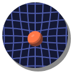 | **The grid is the gravity.** The background grid dents around every mass, so you can see a well before you're in it. |
| 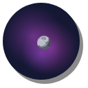 | **Nebulae** hide you from hunters unless they're close, but they slow you down. |
| 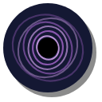 | **Wormholes** throw anything up to 400 mass across the map. The bots know this and use them to escape. |
|  | **Comets** are fast, worth up to 30, and their paths bend around heavy bodies. |
| 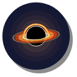 | **Big things decay.** Above 150 mass you slowly shed mass, faster the bigger you get, so giants have to keep eating to stay giants. |
| 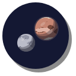 | **Fifty-five rivals**, named after real moons and dwarf planets. Each has its own nerve and appetite: they flee, hunt what they can catch, give up on what they can't, and dive into wormholes when chased. |

Green names are bodies you can eat, anything 20% lighter than you. Red names can eat you. Bodies close to your size bounce off and chip.

<table>
  <tr>
    <td width="50%"></td>
    <td width="50%"></td>
  </tr>
  <tr>
    <td align="center"><sub>A moon just outside a black hole's point of no return.</sub></td>
    <td align="center"><sub>A star about to blow. Two seconds left.</sub></td>
  </tr>
</table>

<p align="center"></p>

## Run it yourself

Open `index.html` in a browser. That's all it needs. To serve it instead:

```sh
python3 -m http.server 8000   # then open http://localhost:8000
```

To host your own copy on GitHub Pages: **Settings → Pages**, set the source to **Deploy from a branch**, pick the branch and the **/ (root)** folder, then **Save**. It appears at `https://<username>.github.io/<repository>/` a minute later.

## How it's made

Plain JavaScript on a 2D canvas, no libraries. Every planet and icon is drawn in code, and every sound is synthesized live with WebAudio, so the game loads no art or audio files.

The look follows a few fixed rules, written up at the top of `js/textures.js`:

- **One light source, top left.** Planets shade away from it, and every button and panel casts its shadow the same way.
- **Hard shading.** Two flat steps, never a smooth gradient.
- **Only light sources glow**, and their glow is stepped.
- **A fixed palette.** Body colours come from eight hues in five tones each. Stars always use real star colours, and accretion disks always burn hot.

<p align="center">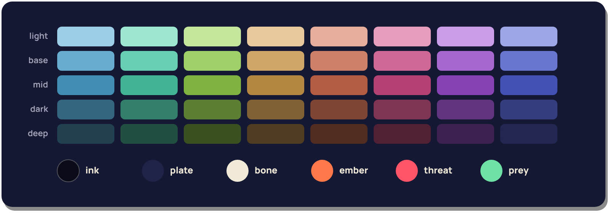</p>

### How it sounds

<p align="center">
  <a href="assets/readme/sound-reel.mp3">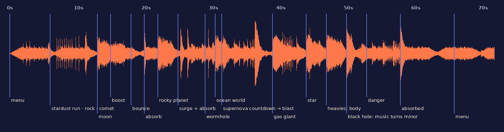</a>
  <br>
  <b><a href="assets/readme/sound-reel.mp3">Listen to the 72-second sound reel</a></b>
  <br>
  <sub>Every sound in the game, in the order you'd meet them, rendered by the game's own audio engine.</sub>
</p>

The sound follows rules too, written up at the top of `js/audio.js`:

- **One key.** Every pitched sound is in D major pentatonic, so nothing clashes with the music or with anything else.
- **Toys in a big room.** Pickups are glassy FM mallets, mass is soft sub-bass, and whooshes are filtered noise. Everything shares one generated reverb, so it all sits in the same space.
- **The music grows with you.** It's generated as you play. Each form adds a layer: more melody, then bass, an arpeggio, high bells. A black hole turns the harmony minor and adds a heartbeat, and being absorbed sinks it under water.
- **Danger is audible.** Being pulled in muffles the music and fades in a low pulse that quickens as the pull gets stronger.
- **Sounds sit where they happen**, panned to the side of the screen they come from and quieter with distance.

The small touches: a run of stardust climbs the scale, so a clean sweep plays a melody. Absorbing a body plays a stab on whatever chord the music is on. Each colour swatch on the menu is its own note, and a supernova's countdown ticks faster as it gets closer.

<details>
<summary><b>Project layout</b></summary>
<br>

```
index.html            page markup: HUD, menu, how-to, death and pause screens
css/style.css         all styling
js/config.js          tuning numbers, forms, colours, bot names
js/world.js           the simulation: gravity, absorbing, collisions, food, events
js/ai.js              bot brains
js/textures.js        procedural surfaces and the art rules
js/renderer.js        canvas drawing
js/audio.js           sound engine, effects and the generative score
js/input.js           mouse, keyboard, touch stick
js/hud.js             HUD, menu and screens
js/game.js            game states, loop, camera, device features
tools/simulate.js     runs the simulation without a browser to check balance
manifest.webmanifest  install-to-home-screen settings
assets/               icons, screenshots and the art on this page
```

</details>

<details>
<summary><b>Tuning the balance</b></summary>
<br>

All the balance numbers live in `js/config.js`. After changing them, run

```sh
node tools/simulate.js 600
```

to play ten minutes of bots-only time without a browser. It prints who's on top every 30 seconds, so you can check that nobody runs away with the system.

</details>

<p align="center"></p>

<p align="center">
  <a href="https://gorzaweba.github.io/Gravity.io/"><b>Play Gravity.io →</b></a>
  <br>
  <sub>Every planet, icon and screenshot on this page comes from the game's own renderer.</sub>
</p>
