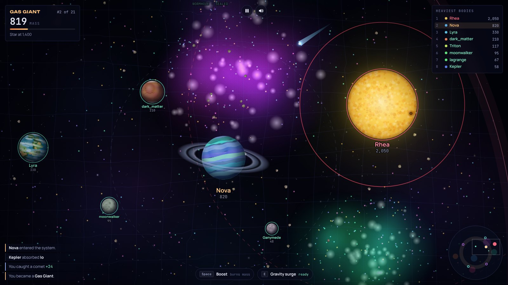
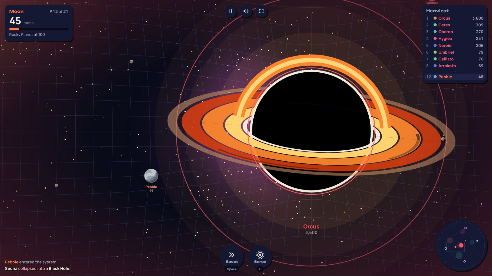

<div align="center">

<a href="https://gorzaweba.github.io/Gravity.io/"></a>

<h1>Gravity.io</h1>

<p><b>Start as a stray rock. Absorb everything lighter than you. Become a black hole.</b></p>

<a href="https://gorzaweba.github.io/Gravity.io/"></a>

<br><br>


</div>

<br>

You are a small asteroid in a crowded star system. Everything with mass pulls on everything lighter than itself, so the space around every heavier body is a trap, and the space around you is a vacuum for stardust, rocks and smaller rivals. Feed, grow, change form, and keep out of the wells of anything bigger than you.

<div align="center">

### [▶ Play Gravity.io](https://gorzaweba.github.io/Gravity.io/)

</div>

## Grow through seven forms


Each form looks different and pulls harder than the one before it.

| Form | Reached at | What changes |
| :--- | ---: | :--- |
| 🪨 Asteroid | start | You absorb stardust and smaller rocks |
| 🌑 Moon | 35 | Heavy enough to absorb comets |
| 🔴 Rocky Planet | 100 | Gravity +8% |
| 🌊 Ocean World | 250 | Gravity +15% |
| 🪐 Gas Giant | 600 | Gravity +25%, wider pull |
| ⭐ Star | 1,400 | Gravity +40% |
| 🕳️ Black Hole | 3,000 | Gravity +80%, but Hawking radiation drains you faster |

## Controls

| | Desktop | Touch |
| :--- | :--- | :--- |
| **Steer** | Mouse (farther cursor = faster) or <kbd>W</kbd><kbd>A</kbd><kbd>S</kbd><kbd>D</kbd> / arrow keys | Drag anywhere. A joystick appears under your thumb |
| **Boost** | Hold <kbd>Space</kbd> or left click. Faster, but burns mass | Hold the Boost button |
| **Gravity surge** | <kbd>E</kbd>, <kbd>Shift</kbd> or right click. Stronger, longer pull for 2.6 s, recharges in 14 s | Tap the Surge button |
| **Pause** | <kbd>Esc</kbd> or <kbd>P</kbd> | Pause button |
| **Sound** | <kbd>M</kbd> | Speaker button |
| **Full screen** | <kbd>F</kbd> or the full-screen button | Full-screen button, or Add to Home Screen |

### On a phone or tablet

- **Portrait or landscape.** The HUD rearranges itself for tall, wide and very small screens.
- **Floating joystick.** Wherever your thumb lands becomes the stick, so your thumb never covers your own planet. A second finger works the Boost and Surge buttons.
- **Install it.** In the browser menu choose **Add to Home Screen**. Gravity.io then opens full screen with its own icon, like an app.
- **Made for small devices.** The screen stays awake while you play, you feel absorptions on phones that support vibration, and the game lowers its resolution automatically if frames start dropping.

## Survive the system

<table>
  <tr>
    <td width="50%"></td>
    <td width="50%"></td>
  </tr>
  <tr>
    <td><b>Point of no return.</b> Every predator gets two red rings. The dashed one is where its gravity starts. Inside the solid one it out-pulls your engine, and only a boost gets you out.</td>
    <td><b>Supernovae.</b> Every 60 to 95 seconds a star collapses. You get 5 seconds of warning. Anything inside the red ring loses 18% of its mass, and the blast leaves stardust and a pulsar worth 45.</td>
  </tr>
</table>

| | |
| :---: | :--- |
| 🌌 | **Spacetime grid.** The background grid sags toward every mass, so you can see a gravity well before you are in it. |
| 🍽️ | **Absorbing.** You can absorb anything at least 20% lighter than you. Closer in size, you bounce off each other and chip off debris. Green names are prey, red names are predators. |
| 🪨 | **Asteroid belt.** A ring of rocks worth 4 to 8 mass each. The best place to feed early on. |
| 🌫️ | **Nebulae.** Bots can't see you inside one unless they are close, but nebulae slow you down. |
| 🌀 | **Wormholes.** Two linked pairs that fling bodies up to 400 mass across the system. Bots use them to escape, and so can you. |
| ☄️ | **Comets.** Fast, worth 18 to 30 mass, and their paths bend around heavy bodies. |
| ⏳ | **Decay.** Above 150 mass you slowly lose mass, faster the bigger you are. Giants have to keep eating to stay giants. |
| 🤖 | **20 rivals.** Bots with their own aggression and caution. They flee, boost, hunt what they can catch, use gravity surge, and dive into wormholes when chased. |
| 🏆 | **Records.** A leaderboard, a minimap, an event feed, and your best run saved in your browser. |
| 🔊 | **Sound.** Every effect is synthesized live with WebAudio. The game ships no audio files. |

## Run it yourself

The game is a static page with no build step. Either:

- **Open `index.html`** in any modern browser. It works straight from the file system.
- **Serve the folder** with any static server, for example:

  ```sh
  python3 -m http.server 8000   # then open http://localhost:8000
  ```

### Host it on GitHub Pages

1. In the repository, open **Settings → Pages**.
2. Under **Build and deployment**, set **Source** to **Deploy from a branch**.
3. Pick the branch that holds the game and the **/ (root)** folder, then **Save**.

A minute later the game is live at `https://<your-username>.github.io/<repository-name>/`. The empty `.nojekyll` file tells Pages to serve the files as they are.

## Under the hood

<details>
<summary><b>Project layout</b></summary>

```
index.html        page, HUD and menu markup
css/style.css     all styling
js/config.js      every tuning constant, the evolution ladder, bot names
js/util.js        math, RNG and formatting helpers
js/entities.js    Body (players and bots), food, spatial grid
js/world.js       the simulation: gravity, absorption, collisions, food, events
js/ai.js          bot brains
js/textures.js    procedural planet, star and sprite textures
js/renderer.js    canvas rendering
js/audio.js       synthesized sound effects
js/input.js       mouse, keyboard, touch joystick
js/hud.js         stats, leaderboard, minimap, feed, menu and death screens
js/game.js        state machine, loop, camera, event handling
tools/simulate.js headless balance simulation
manifest.webmanifest  install-to-home-screen settings
assets/           icons, README and link-preview images
```

</details>

<details>
<summary><b>How the gravity works</b></summary>

Every body pulls lighter bodies with an inverse-square force. The pull fades out at 4.5 radii and never reaches further than 2,300 units. Each form multiplies the strength and reach. Gravity also vacuums stardust toward you, so bigger bodies feed faster.

The "point of no return" ring is the distance where a predator's pull equals your top thrust: `sqrt(G × strength × mass ÷ your thrust)`. Boosting nearly doubles your thrust, which is why a boost can still save you inside it.

</details>

<details>
<summary><b>Tuning the balance</b></summary>

Every number that affects balance is in `js/config.js`. The simulation in `js/world.js` does not touch the DOM, so it also runs without a browser:

```sh
node tools/simulate.js 600   # 10 minutes of bot-only play
```

It prints the leaderboard every 30 seconds and counts every event at the end. Use it to check that no single bot runs away with the system after you change a number.

</details>
