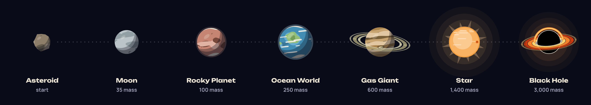
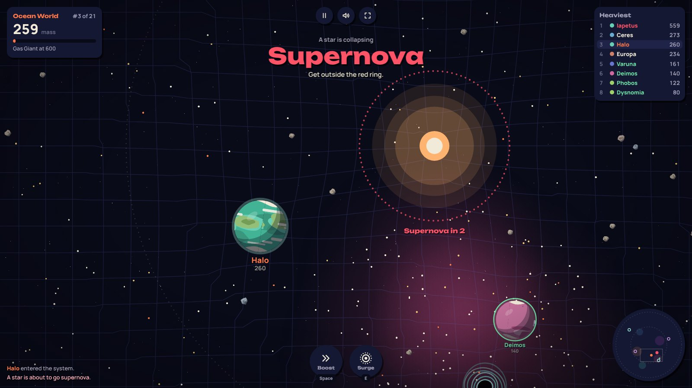

<a href="https://gorzaweba.github.io/Gravity.io/"></a>

# Gravity.io

**Eat what's smaller. Run from what's bigger. Become a black hole.**

**[Play it in your browser →](https://gorzaweba.github.io/Gravity.io/)**

You start as a rock the size of a pebble. Everything with mass pulls on everything lighter than itself, so the space around you is a vacuum for stardust and smaller bodies, and the space around anything heavier is a trap. Grow through seven forms, and keep out of the wells of the things that want to eat you.

It runs on phones, tablets and desktops, with no install, no account and no build step.



| Form | Reached at | What changes |
| :--- | ---: | :--- |
| Asteroid | start | You absorb stardust and smaller rocks |
| Moon | 35 | Heavy enough to swallow comets |
| Rocky Planet | 100 | Gravity +8% |
| Ocean World | 250 | Gravity +15% |
| Gas Giant | 600 | Gravity +25%, wider pull |
| Star | 1,400 | Gravity +40% |
| Black Hole | 3,000 | Gravity +80%, but Hawking radiation eats your mass faster |

## Controls

| | Desktop | Phone or tablet |
| :--- | :--- | :--- |
| Steer | Mouse (the farther the cursor, the faster), or WASD / arrow keys | Drag anywhere. A stick appears under your thumb |
| Boost | Hold Space or left click. Faster, but it burns mass | Hold the Boost button |
| Gravity surge | E, Shift or right click. Pull 2.2× harder for 2.6 s, then 14 s to recharge | Tap the Surge button |
| Pause, sound, full screen | Esc, M, F | Buttons at the top |

On a phone, **Add to Home Screen** turns it into a full-screen app with its own icon.

## Staying alive

<table>
  <tr>
    <td width="50%"></td>
    <td width="50%"></td>
  </tr>
  <tr>
    <td><b>The red rings.</b> When something heavy is pulling on you, two rings show up around it. The dotted one is where its pull starts. Inside the solid one, its pull is stronger than your engine, and only a boost gets you out.</td>
    <td><b>Supernovae.</b> Every 60 to 95 seconds a star starts pulsing. You have five seconds to get outside its red ring. Anything caught inside loses 18% of its mass. Afterwards there is stardust everywhere and a pulsar worth 45.</td>
  </tr>
</table>

- **Food and threats are colour-coded.** Green names are bodies you can eat (anything 20% lighter than you). Red names can eat you. Bodies close to your size bounce off you and chip.
- **The grid is the gravity.** The background grid dents around every mass, so you can see a well before you're in it.
- **Nebulae** hide you from hunters unless they're close, but they slow you down.
- **Wormholes** throw anything up to 400 mass across the map. The bots know this and use them to escape.
- **Comets** are fast, worth up to 30, and their paths bend around heavy bodies.
- **Big things decay.** Above 150 mass you slowly shed mass, faster the bigger you get, so giants have to keep eating to stay giants.

You share the system with 20 bots named after real moons and dwarf planets. Each has its own nerve and appetite: they flee, hunt what they can catch, give up on what they can't, and dive into wormholes when chased.

## Run it yourself

Open `index.html` in a browser. That's it. To serve it instead:

```sh
python3 -m http.server 8000   # then open http://localhost:8000
```

To host your own copy on GitHub Pages: **Settings → Pages**, source **Deploy from a branch**, pick the branch and the **/ (root)** folder, **Save**. It appears at `https://<username>.github.io/<repository>/` a minute later.

## How it's made

Plain JavaScript on a 2D canvas, no libraries. Every planet, star and icon is drawn in code, and the sound is synthesized live with WebAudio, so the repository has no audio files, and its only images are the screenshots and app icons, which the game's own renderer drew.

The look follows a few fixed rules, written up at the top of `js/textures.js`:

- One light source, top left. Planets shade away from it, and every button and panel casts its shadow the same way.
- Shading is two hard steps, never a smooth gradient.
- Only things that give off light glow, and their glow is stepped.
- Body colours come from eight hues, each in five fixed tones. Stars always use real star colours, and accretion disks always burn hot.
- Stardust chimes up a pentatonic scale when you eat it in a run.

```
index.html            page markup: HUD, menu, how-to, death and pause screens
css/style.css         all styling
js/config.js          tuning numbers, forms, colours, bot names
js/world.js           the simulation: gravity, absorbing, collisions, food, events
js/ai.js              bot brains
js/textures.js        procedural surfaces and the art rules
js/renderer.js        canvas drawing
js/audio.js           synthesized sound
js/input.js           mouse, keyboard, touch joystick
js/hud.js             HUD, menu and screens
js/game.js            game states, loop, camera, device features
tools/simulate.js     runs the simulation without a browser to check balance
manifest.webmanifest  install-to-home-screen settings
```

All the balance numbers live in `js/config.js`. After changing them, `node tools/simulate.js 600` plays ten minutes of bots-only time headless and prints who's on top every 30 seconds, so you can check that nobody runs away with the system.
